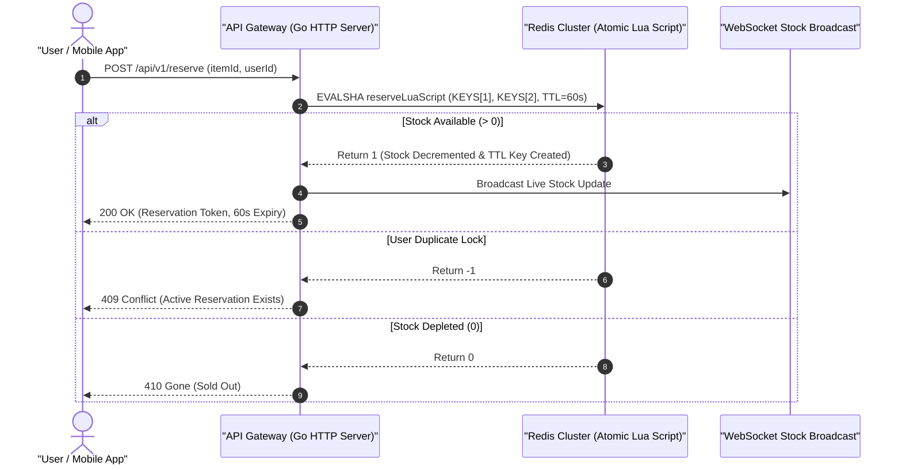

# ⚡ Sneaker-Drop-System — High-Concurrency Flash Sale Engine

[](https://golang.org)
[](https://redis.io)
[](LICENSE)

**What This System Solves:** Prevents two customers from buying the exact same last item or booking slot during flash-sale traffic spikes.

> A high-concurrency distributed inventory reservation engine in Go built to handle flash sales without stock overselling, race conditions, or database lock contention.

---

## 📐 Architecture & Data Flow



---

## 💡 Technical Challenges & Engineering Solutions

| Bottleneck / Challenge | Naive Approach | Go + Redis Lua Engineering Solution |
| --- | --- | --- |
| **Race Conditions / Stock Overselling** | `SELECT stock FROM items` followed by `UPDATE items SET stock = stock - 1` | **Atomic Lua Scripting (`EVALSHA`)**: Executes check-and-decrement in one atomic Redis step with 60s TTL expiration. |
| **Duplicate Reservation Attempts** | Multiple rows inserted under burst retries | **Per-User Idempotency Key (`-1`)**: Rejects duplicate active holds cleanly at `HTTP 409 Conflict`. |
| **Real-Time Stock Propagation** | Polling HTTP `/stock` endpoint from frontend clients | **Gorilla WebSocket Hub**: Pushes live stock updates directly to connected clients on state transitions. |

---

## 📊 Concurrency & Load Test Verification

* **Concurrency Race Tests (`go test -v -race ./...`):** Verifies atomic lifecycle, 60s expiration sweep recovery, and **0.00% oversell** across parallel reservation goroutines against live Redis.
* **k6 Stress Suite (`tests/load/k6_stress_test.js`):** Exercises bursts ramping up to **2,000 Virtual Users (VUs)** validating `0.00%` oversell under contention.

---

## 🛠️ Quickstart

```bash
# Clone repository
git clone https://github.com/shafiktanbir/Sneaker-Drop-System.git
cd Sneaker-Drop-System

# Start app & Redis with Docker Compose
docker compose up -d

# Test reservation request
curl -X POST http://localhost:8080/api/v1/reserve \
  -H "Content-Type: application/json" \
  -d '{"itemId": "sneaker-nike-v1", "userId": "usr_992"}'
```

